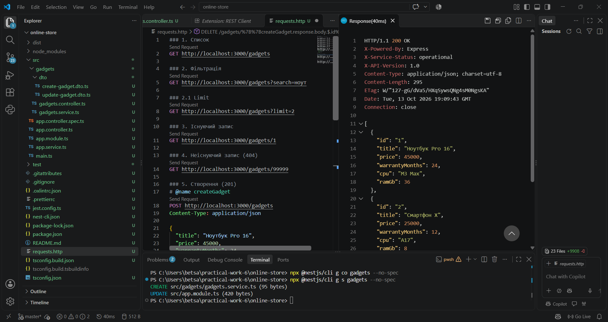
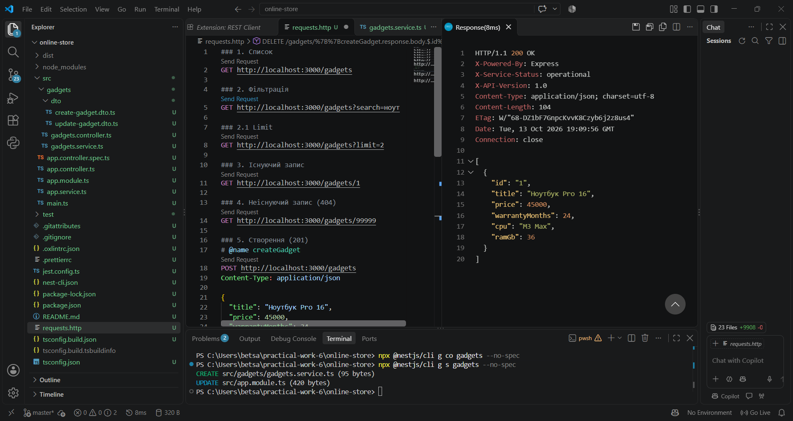
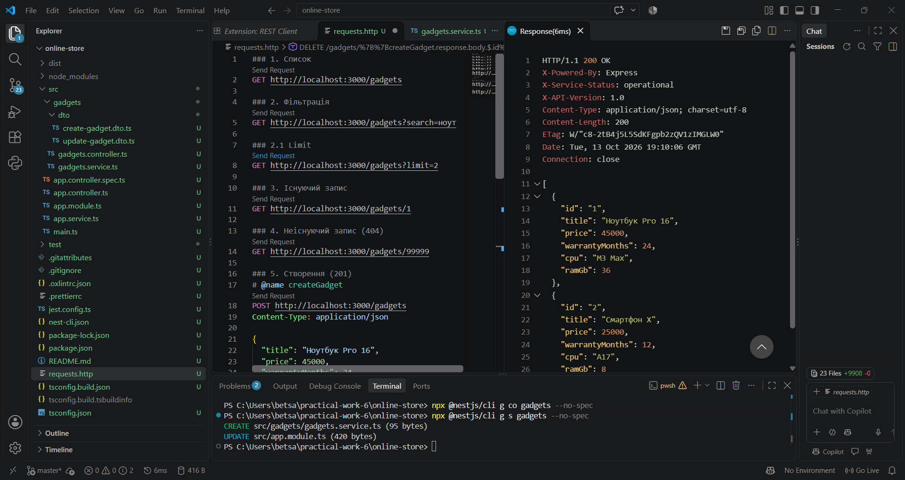
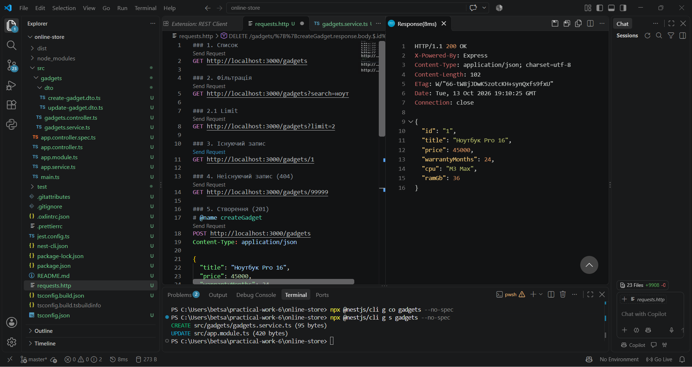
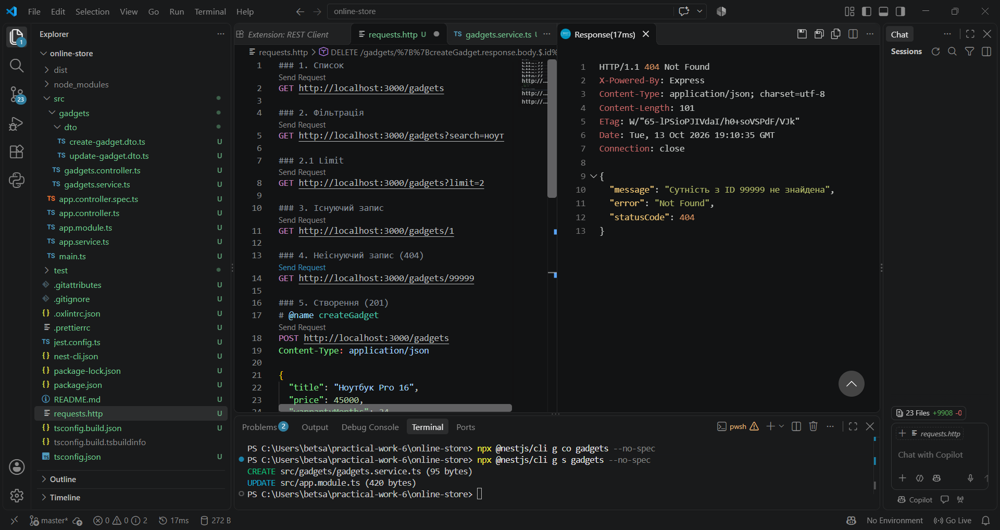
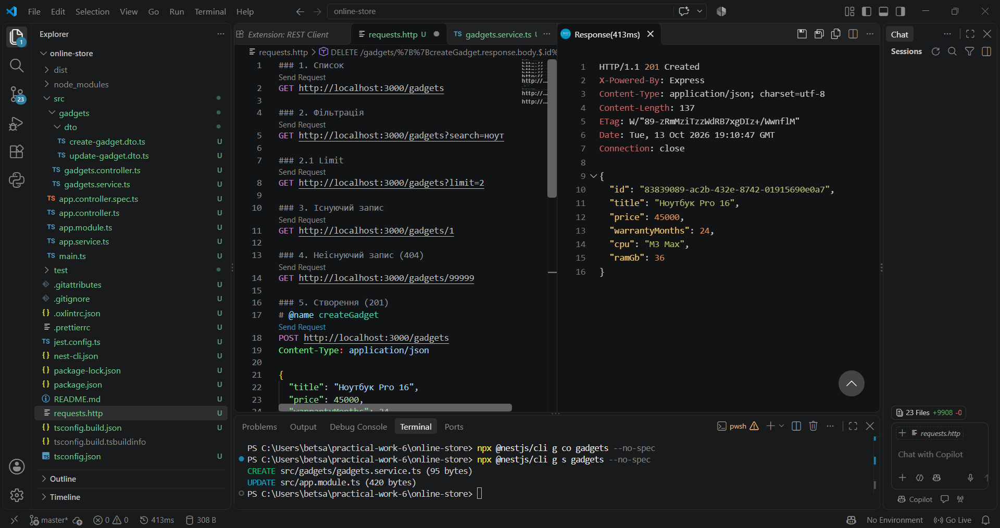
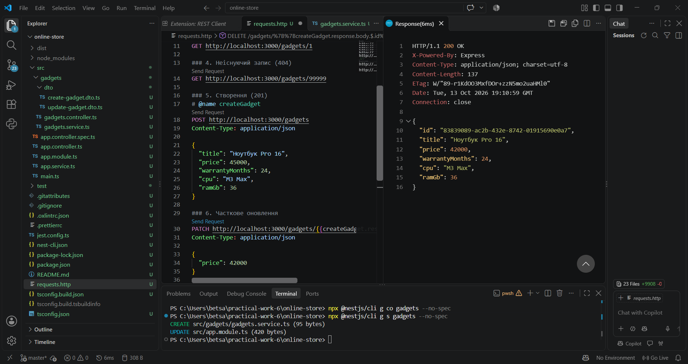
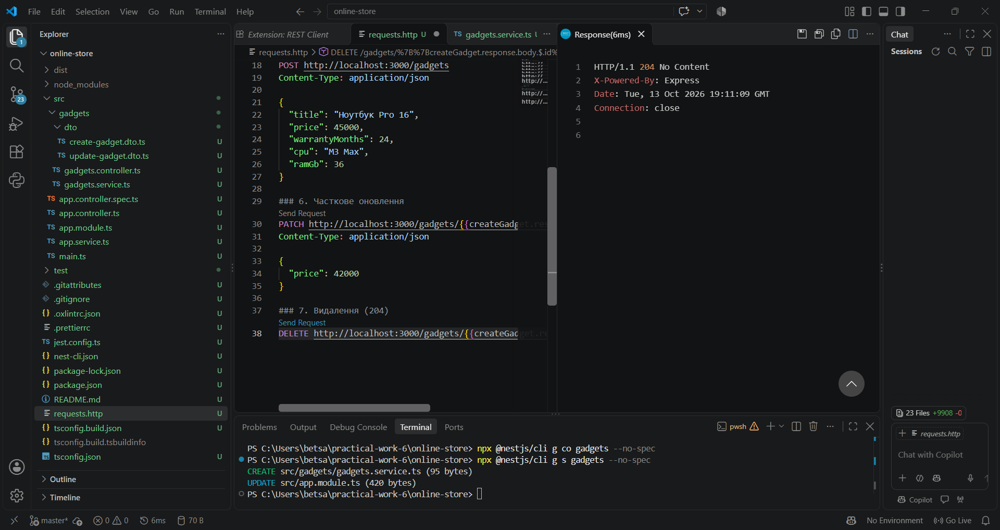

# Практична робота №4. REST-ендпоінти на NestJS

Варіант 1: Електроніка та гаджети, маршрут `/gadgets`.

## Опис

REST API для керування гаджетами інтернет-магазину на NestJS. Реалізовано CRUD, query-фільтрацію, DTO, in-memory сервіс, обробку виключень та кастомні заголовки відповіді.

Поля сутності: `title`, `price`, `warrantyMonths`, `cpu`, `ramGb`.

## Структура

- `src/gadgets/gadgets.controller.ts` — контролер, маршрути та декоратори
- `src/gadgets/gadgets.service.ts` — бізнес-логіка та in-memory сховище
- `src/gadgets/dto/` — `CreateGadgetDto`, `UpdateGadgetDto`
- `requests.http` — запити для тестування (VS Code REST Client)

## Запуск

```bash
npm install
npm run start:dev
```

Сервер: http://localhost:3000

## Ендпоінти

| Метод | Маршрут | Опис | Статус |
|-------|---------|------|--------|
| GET | /gadgets | Список (`?search=`, `?limit=`) | 200 |
| GET | /gadgets/:id | Один запис | 200 / 404 |
| POST | /gadgets | Створення | 201 |
| PATCH | /gadgets/:id | Часткове оновлення | 200 / 404 |
| DELETE | /gadgets/:id | Видалення | 204 / 404 |

Заголовки відповіді для `GET /gadgets`: `X-API-Version: 1.0`, `X-Service-Status: operational`.

## Результати тестування

### Запуск сервера (без помилок)


### GET /gadgets


### GET /gadgets?search=ноут


### GET /gadgets?limit=2


### GET /gadgets/1


### GET /gadgets/99999 (404 Not Found)


### POST /gadgets (201 Created)


### PATCH /gadgets/:id


### DELETE /gadgets/:id (204 No Content)
